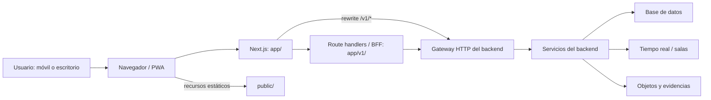

# Guía técnica del frontend SIAE

Este documento describe el frontend que existe en el repositorio, cómo se organiza y cómo se comporta la PWA. Para los comandos rápidos de instalación, desarrollo y Docker, empezar en el [README del proyecto](../../README.md).

> La implementación puede cambiar antes que esta guía. Para verificar un detalle operativo, prevalecen `package.json`, `next.config.ts`, `docker-compose.yml`, `Dockerfile` y el código referenciado.

## Alcance y arquitectura

El frontend es una aplicación Next.js con App Router. Entrega las páginas y recursos al navegador, implementa algunas rutas de servidor/BFF en `app/v1/` y reenvía las rutas `/v1/*` restantes al gateway HTTP del backend. El backend de negocio es un proyecto separado; no está incluido como código fuente funcional del frontend.



`BACKEND_API_URL` es la dirección que usa el proceso servidor de Next.js. Debe ser alcanzable **desde donde se ejecuta Next.js**, no necesariamente desde el navegador. Por eso los valores cambian según el modo:

| Proceso frontend | Dirección típica del backend |
|---|---|
| Next.js ejecutándose en el host; backend publica `8050` en el host | `http://127.0.0.1:8050` |
| Next.js en un contenedor de la red del backend | `http://siae-app:8080` |
| Frontend en Docker y backend en el host | `http://host.docker.internal:8050` |

La configuración de `next.config.ts` usa `http://127.0.0.1:8050` como fallback. `docker-compose.yml` usa `http://siae-app:8080`, y el `Dockerfile` incorpora el destino durante el build. Si el gateway emplea otros puertos o nombres, sustituirlos por los publicados/configurados por el backend local.

El rewrite especial `/v1/salas/:id/unirse` se traduce a `/v1/salas/:id/join`; las demás rutas `/v1/:path*` se reenvían conservando el path.

## Distinguir código funcional de herramientas y archivos locales

| Directorio/archivo | Uso |
|---|---|
| `app/` | Páginas, layouts y Route Handlers de Next.js; incluye la capa BFF bajo `app/v1/`. |
| `src/components/` | Componentes de interfaz compartidos y de dominio. |
| `src/features/` | Áreas de producto que agrupan componentes y estado de una experiencia. |
| `src/modules/` | Lógica reutilizable por dominio: auth, emergencia, RTT, sala, perfiles, notificaciones, outbox, geolocalización, accesibilidad y catálogos. |
| `src/hooks/`, `src/lib/`, `src/data/`, `src/styles/` | Hooks, utilidades, datos de producto y estilos usados por la aplicación. |
| `lib/`, `types/` | Helpers y tipos compartidos fuera de `src/`, incluidos helpers usados por Route Handlers. |
| `public/` | Recursos servidos directamente por URL. El manifest y `sw.js` son parte funcional de la PWA; informes HTML conservan sus URLs actuales. |
| `tests/`, `e2e/` | Pruebas automatizadas Vitest y Playwright; aquí viven también MSW y fixtures de prueba, no se cargan en el runtime de producción. |
| `tests/manual/`, `audits/` | Scripts optativos que el desarrollador ejecuta a mano. No se importan como parte de la aplicación ni se ejecutan con los comandos de pruebas estándar. |
| `docs/` | Documentación y diagramas; no se incluyen como código de la aplicación. |
| `.local/`, `.env.local` | Material privado/local de trabajo; excluido por `.gitignore`. |
| `.next/`, `coverage/`, `test-results/`, `playwright-report/` | Salidas generadas por build y pruebas; excluidas por `.gitignore`. |

Las carpetas `tests/manual/` y `audits/` se mantienen separadas de las pruebas automáticas y de `app/`/`src/` para no confundir herramientas de verificación con código que se publica. Los scripts se conservan versionables para que el equipo pueda revisarlos y compartirlos. No se ignoran con Git; solo sus artefactos generados se excluyen.

## Mapa de rutas

Las carpetas de primer nivel de `app/` se corresponden con rutas web:

| Ruta | Experiencia |
|---|---|
| `/` | Inicio ciudadano: portal web o flujo ciudadano según contexto y perfil. |
| `/onboarding`, `/register`, `/login` | Introducción, registro e inicio de sesión. |
| `/tipificar`, `/ubicacion`, `/confirmar` | Tipificación de emergencia, localización y confirmación. |
| `/camino-seguro` | Flujo de Camino Seguro. |
| `/perfil`, `/perfil/notificaciones`, `/ajustes`, `/historial` | Perfil, preferencias, notificaciones e historial. |
| `/offline` | Estado sin conexión y vías alternativas de contacto. |
| `/operador`, `/operador/ajustes` | Puesto de atención/operación PSAP. |
| `/despachador` | Consola de despacho CAD. |
| `/dashboard` | Panel estratégico. |
| `/admin` y `/admin/*` | Administración: usuarios, organismos, cuadrantes, CINT, tipificaciones, reportes, auditoría y ajustes. |
| `/sala/[id]`, `/sala-operaciones` | Sala de emergencia y operaciones. |
| `/v1/*` | Route Handlers/BFF de Next.js; no son páginas de navegación. |

Las pantallas requieren los servicios externos correspondientes para operar. Sin el backend, el frontend no debe considerarse operativo; los estados vacíos y errores corresponden a respuestas reales, no a datos de demostración.

## Datos reales y aislamiento de pruebas

Las rutas del frontend reenvían al backend y las acciones operativas solo se consideran completadas cuando el servidor las confirma. Una respuesta vacía sigue siendo vacía; un error de red o HTTP se presenta como error y no se reemplaza por datos locales de ejemplo. En particular, la consola CInt solo puede abrir una sala cuyo identificador haya sido devuelto por el backend.

Los handlers MSW y los datos fixture se encuentran en `tests/` y se importan únicamente desde las pruebas. No existe una variable de entorno para activar mocks en el navegador ni en el runtime de Next.js. Las pruebas unitarias pueden simular respuestas HTTP explícitamente para verificar éxito y error sin insertar esas simulaciones en la aplicación.

### Integraciones deshabilitadas por falta de API verificable

- La auditoría forense no genera ni descarga manifiestos y `/v1/audit/manifest` responde `501` hasta que exista un servicio backend que valide y persista la evidencia.
- La rotación de claves no se ejecuta localmente. `/v1/admin/keys/rotate` responde `501` mientras no haya un servicio de gestión criptográfica conectado.
- El CAD no incluye una flota ni un directorio externo de demostración. El despacho de unidades, el registro de contactos, la bitácora y el cierre de expedientes permanecen deshabilitados hasta contar con las API correspondientes; las pestañas En Ruta y Cerrados reflejan únicamente estados entregados por el backend.
- La sala no presenta seguimiento local de unidades ni ETAs calculados en el navegador.
- La transcripción de voz en tiempo real y la sala local de atención en puesto no están integradas a un servicio de backend; no se aceptan mensajes genéricos del navegador como transcripciones.
- No presentar avisos de indisponibilidad como confirmación de una operación. La existencia de una pantalla o ruta BFF no demuestra que haya persistencia en el backend.

## Funciones y módulos

Los nombres siguientes resumen los módulos del árbol actual, no garantizan que cada integración externa esté desplegada:

- `src/features/citizen-portal` y `citizen-profile`: portal ciudadano y perfil.
- `src/features/operator-psap` y `dispatcher-cad`: consolas de atención y despacho.
- `src/features/admin-governance` y `dashboard-metrics`: administración y métricas.
- `src/modules/auth`: estado de sesión, validación, registro y passkeys.
- `emergency`, `typification`, `geo`, `psap`: activación, tipificación, ubicación y operaciones PSAP.
- `room`, `rtt`, `notifications`: comunicación en tiempo real, salas y notificaciones.
- `outbox`, `profile`: persistencia local, sincronización y perfiles.
- `a11y`, `i18n`: accesibilidad e internacionalización.
- `ai`: asistencia, subtítulos y capacidades relacionadas.

Las tecnologías principales se identifican en `package.json`: Next.js 16, React 19, TypeScript, Tailwind CSS 4, TanStack Query, Zustand, Dexie/IndexedDB, MapLibre, LiveKit y Vitest/Playwright.

## PWA y diferencias entre teléfono y web

### Una aplicación, más de una presentación

La PWA no es una app móvil nativa distinta ni una segunda implementación web. El navegador carga la misma aplicación y la misma ruta. El `manifest.webmanifest` solicita presentación `standalone`, orientación vertical, nombre/iconos y accesos directos; los estilos son adaptables y la aplicación consulta el contexto del dispositivo.

En `src/hooks/use-device-context.ts`, la clasificación de móvil se basa en un ancho de ventana menor de 768 píxeles, no en una detección infalible del tipo de hardware. También se comprueba si se ejecuta en modo standalone. La página `/` usa ese contexto y el estado local del perfil para escoger entre el portal de escritorio ciudadano y el flujo ciudadano. La selección no implica que todas las pantallas tengan una versión separada.

| Contexto | Comportamiento relevante |
|---|---|
| Teléfono en navegador | Carga la aplicación web móvil; según perfil, el inicio ciudadano muestra el portal o el flujo principal. El navegador conserva su barra e interfaz. |
| Teléfono con PWA instalada | Abre el mismo sitio en modo standalone, sin la interfaz normal del navegador; `/` usa el contexto instalado al decidir la experiencia. La instalación no concede permisos de ubicación, cámara, micrófono ni notificaciones automáticamente. |
| Navegador de escritorio | Para un perfil ciudadano no anónimo, `/` muestra el portal ciudadano de escritorio; desde allí se puede iniciar el flujo SOS. El resto de rutas comparte el mismo frontend. |
| PWA instalada en escritorio/tablet | Usa el modo standalone, pero no por ello se convierte en una aplicación nativa; algunas capacidades y el diseño siguen dependiendo del navegador, el ancho y los permisos. |
| Consolas de personal | Las rutas y permisos dependen de la sesión/rol. El aviso de instalación no se presenta en todas las consolas ni para usuarios con rol distinto de solicitante. |

En iOS/iPadOS el componente proporciona instrucciones para **Compartir → Añadir a pantalla de inicio**. En navegadores que exponen `beforeinstallprompt`, como Chrome/Edge compatibles, el componente ofrece la acción de instalación del navegador. Los nombres y disponibilidad de la opción dependen de la versión del sistema y el navegador.

Para ubicación, cámara, micrófono, notificaciones y otras funciones del dispositivo se aplican permisos y limitaciones de la plataforma. Para instalación, service workers y varias APIs del navegador, probar desde `localhost` o servir el sitio por HTTPS. Abrir `http://<IP-de-la-PC>:3000` desde un teléfono no equivale a `localhost` seguro.

### Qué hace actualmente el service worker

`src/components/providers/AppProviders.tsx` registra `/sw.js` únicamente cuando `NODE_ENV` es `production`. Por eso `npm run dev` no es una prueba suficiente de la instalación ni del comportamiento offline.

El service worker de `public/sw.js` actualmente:

1. precarga una lista acotada de rutas y recursos de shell;
2. para navegaciones intenta primero la red y, si falla, presenta `/offline` o una ruta de shell disponible;
3. para solicitudes GET consulta primero el cache y guarda respuestas exitosas del mismo origen; deja pasar solicitudes que no sean GET;
4. presenta notificaciones push y gestiona el clic en la notificación si el navegador y la suscripción están configurados;
5. si recibe un evento de sincronización `siae-outbox-sync`, notifica a las ventanas abiertas. El envío de la cola lo ejecuta la aplicación, no el service worker por sí solo.

El caché no convierte todas las funciones en offline-first: una solicitud o pantalla puede seguir necesitando servidor y red. Para validar actualizaciones durante desarrollo de la PWA, inspeccionar/actualizar el service worker desde las herramientas del navegador o borrar sus datos del sitio.

### Cola de emergencia offline: límites importantes

El flujo de emergencia puede guardar solicitudes en la outbox local mediante Dexie/IndexedDB y volver a intentar la sincronización al recuperar conectividad. Si IndexedDB no está disponible, el helper define una alternativa de almacenamiento local. La app reintenta mientras hay conectividad y comunica eventos al service worker cuando el navegador lo admite.

Esto **no garantiza** entrega inmediata, ejecución con la app cerrada, entrega del backend ni disponibilidad de geolocalización, RTC o mapas sin red. Una emergencia guardada localmente no ha sido recibida por el operador hasta que la API confirme el envío. Si la conexión falta, la página `/offline` ofrece alternativas de llamada/SMS; la disponibilidad real depende de la red móvil y el servicio telefónico.

La interfaz de `/offline` describe la cola como cifrada, pero el código actual persiste el objeto de la outbox directamente en el almacén local y no cifra ese `payload` en ese camino. **No tratar la cola como cifrada en reposo ni usar datos reales sensibles para pruebas locales** hasta implementar y validar protección de almacenamiento adecuada.

```mermaid
sequenceDiagram
    participant U as Usuario
    participant A as Aplicación/PWA
    participant I as IndexedDB (outbox)
    participant SW as Service worker
    participant API as Backend
    U->>A: Confirma una emergencia
    alt Hay conexión
        A->>API: Envía solicitud
        API-->>A: Confirma o devuelve error
    else Sin conexión / error de red
        A->>I: Guarda solicitud pendiente
        A-->>U: Indica estado pendiente
    end
    Note over SW: Sync puede despertar/reavisar a ventanas; el envío pertenece a la app.
    A->>I: Lee pendientes al detectar conexión
    A->>API: Reintenta mientras la app puede ejecutar
    API-->>A: Confirma recepción
    A->>I: Actualiza estado de la solicitud
```

## Configuración local y variables

El repositorio tiene `.env.example` y `.env.production.example`. No copiar secretos reales a un archivo versionado. `.env.local` y `.env` están excluidos por `.gitignore`; `.env` se necesita además como `env_file` del Compose del frontend.

| Variable | Dónde se usa | Consideración |
|---|---|---|
| `BACKEND_API_URL` | Servidor Next.js, rewrites y Route Handlers/BFF. | No es pública. Usar dirección distinta según el proceso esté en el host o dentro de Docker. |
| `NEXT_PUBLIC_WS_URL` | Conexión RTT/WebSocket desde navegador. | Apuntar a la URL WS/WSS alcanzable por el navegador y permitida por CSP. Se fija al construir el frontend. |
| `NEXT_PUBLIC_LIVEKIT_URL` | Fallback de URL para salas LiveKit. | El endpoint debe ser accesible por el navegador y corresponder al entorno. Se fija al construir el frontend. |
| `NEXT_PUBLIC_VAPID_KEY` | Suscripciones Web Push en navegador. | Es la clave **pública** VAPID; para push real hace falta configurar la pareja compatible en el backend. El valor ilustrativo del ejemplo no es una clave operativa. Se fija al construir el frontend. |
| `NEXT_PUBLIC_API_URL`, `NEXT_PUBLIC_API_BASE` | Aparecen en el ejemplo de entorno. | No se identificó consumo directo de estas dos variables en el código frontend revisado; no sustituyen `BACKEND_API_URL` para las rutas Next.js. |
| `DB_HOST`, `DB_PORT`, `DB_USER`, `DB_PASSWORD`, `DB_NAME` | Helper de almacenamiento en `lib/storage-helper.ts`. | Valores de servidor; no exponer ni añadir prefijo `NEXT_PUBLIC_`. |
| `S3_ENDPOINT`, `MINIO_ROOT_USER`, `MINIO_ROOT_PASSWORD`, `S3_BUCKET_MEDIA`, `S3_BUCKET_GRABACIONES` | Helper de almacenamiento S3/MinIO. | Configurar solo donde se ejecute esa integración; usar credenciales locales de desarrollo y no publicarlas. |

La plantilla `.env.example` contiene URLs de ejemplo y claves ficticias. Verificar y corregir puertos para la topología local antes de usarla: el fallback de Next.js es `8050`, el Compose del frontend usa el servicio `siae-app:8080`, y el backend decide qué puertos expone al host.

## Ejecutar con backend en Docker y frontend en modo desarrollo

Esta modalidad permite depurar el frontend con `next dev` y conectar con un backend local:

1. Iniciar el backend desde su propio repositorio, siguiendo su documentación y verificando qué puerto publica en el host.
2. En la raíz del frontend, configurar `BACKEND_API_URL`. Si el puerto publicado es `8050`:

   ```powershell
   $env:BACKEND_API_URL = "http://127.0.0.1:8050"
   npm ci
   npm run dev
   ```

3. Navegar a `http://localhost:3000`. No añadir `/v1` al valor de `BACKEND_API_URL`.

Si la dirección debe persistir, escribir las dos variables en `.env.local` en vez de definirlas en cada terminal.

## Ejecutar frontend y backend en Docker Compose

El Compose de este repositorio:

- compila el modo standalone de Next.js con Node 20;
- publica `3000:3000`;
- carga `.env` en el contenedor para las variables de runtime;
- toma las variables públicas enumeradas abajo de `.env` y las pasa explícitamente al build;
- fija `BACKEND_API_URL=http://siae-app:8080`;
- requiere la red Docker externa `grpc_default`.

Next.js incorpora las referencias `NEXT_PUBLIC_*` al JavaScript del navegador **en el momento de `next build`**. RTT, LiveKit y Push requieren configurar `NEXT_PUBLIC_WS_URL`, `NEXT_PUBLIC_LIVEKIT_URL` y `NEXT_PUBLIC_VAPID_KEY` en `.env` antes de construir si se usan. Tras cambiar cualquiera de estos valores, reconstruir con `docker compose up --build -d`. No colocar secretos privados en variables `NEXT_PUBLIC_*` ni en argumentos de build.

El contexto Docker contiene los archivos necesarios para compilar Next.js y los recursos de `public/`. `.dockerignore` excluye `.env*`, archivos Markdown, `.local/`, backend/archivo comprimido, pruebas, auditorías, documentación, configuraciones Vitest/Playwright y artefactos locales. Compose todavía puede leer el `.env` local para interpolar sus argumentos y como `env_file`; excluirlo del contexto evita copiarlo en las capas de build, pero no elimina las variables que Compose inyecta al ejecutar el contenedor.

Por tanto, iniciar primero el backend y luego, desde la raíz del frontend:

```powershell
if (-not (Test-Path .env)) { Copy-Item .env.example .env }
# Revisar .env y reemplazar valores de ejemplo según el backend local.
docker compose up --build -d
docker compose ps
```

Revisar los logs con `docker compose logs -f siae-web`. Para cerrar solo el frontend, `docker compose down` en su carpeta. Ejecutar el mismo comando en el proyecto backend para detenerlo. No borrar volúmenes salvo que se quiera eliminar explícitamente la persistencia local de la base de datos.

El nombre `siae-app` y puerto `8080` son valores de red interna declarados por el Compose del frontend; deben coincidir con el servicio real del backend. Cambiar el destino implica reconstruir el frontend, porque las rewrites se calculan durante el build.

## Pruebas, lint y compilación

```powershell
npm run lint
npm run typecheck
npm test
npm run build
```

Vitest incluye `tests/**/*.test.ts(x)` y usa jsdom; la configuración excluye E2E, `Grpc/`, `node_modules/` y `.next/`. Playwright usa `e2e/`, un solo worker y Chromium:

```powershell
npx playwright install chromium
npm run test:e2e
```

La configuración de Playwright levanta `npm run dev` y reutiliza un servidor disponible en `http://localhost:3000`. Para probar PWA instalada, service worker y modo offline real, además ejecutar una compilación y servirla con `npm run start`, luego verificar el sitio desde DevTools/dispositivo. Los tests de jsdom no sustituyen la validación en un navegador móvil real.

Los scripts:

- `tests/manual/*.mjs`: validaciones manuales y contra servicios, incluyendo persistencia y recorridos visuales;
- `audits/*.mjs`: auditorías y escenarios de recorrido/operación;
- no se ejecutan automáticamente por los scripts estándar del `package.json`.

Leer los scripts antes de lanzarlos: algunos automatizan operaciones contra servicios, requieren datos/cuentas de desarrollo o guardan resultados en `test-results/`.

## Accesibilidad y capacidades del dispositivo

La interfaz incluye preferencias de accesibilidad, pictogramas/lectura fácil, anuncios para tecnología de asistencia y respuestas hápticas o de audio donde el dispositivo lo permite. La disponibilidad de vibración, voz, cámara, ubicación, notificaciones y passkeys depende del navegador, del hardware, del modo de instalación, de permisos y de HTTPS. Una API no disponible no se debe interpretar como fallo del servicio de emergencia; validar siempre recorridos accesibles con teclado y lector de pantalla, además de los tamaños móviles.

## Diagramas e informes

Los diagramas de arquitectura y ciclo PWA están en este documento. Los informes HTML históricos de auditoría y robustez continúan en `public/` para no cambiar sus URLs públicas; no son especificaciones canónicas y no se deben confundir con código funcional.

## Convenciones de archivos locales

- Guardar secretos de desarrollo en `.env.local` o `.env`, no en README ni en variables públicas.
- Se puede usar `.local/` para notas, fixtures privados o archivos locales que no deban subir al repositorio. La ruta raíz `/.local/` está ignorada por Git.
- Los scripts en `audits/` y `tests/manual/` sí se mantienen versionables; que no formen parte del runtime no significa que se deban perder.
- Las salidas temporales de Vitest/Playwright/build y los logs se excluyen en `.gitignore`.

## Límites y dependencias externas

El frontend no contiene ni reemplaza el backend. Las rutas BFF y rewrites necesitan que la API sea compatible y esté disponible. RTT, LiveKit, notificaciones push, geolocalización, mapas y almacenamiento requieren servicios, configuración, permisos/red o claves de entorno adecuados. Un contenedor frontend saludable solo confirma que Next.js está ejecutándose; no prueba por sí mismo que los servicios integrados estén operativos.
